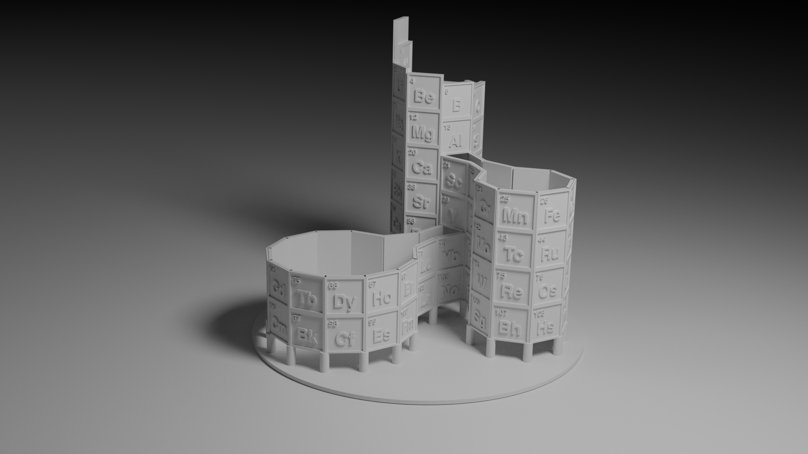

# 3D periodic table columns

Relief columns (solid square, raised frame, symbol and atomic number) for a 3D periodic table after
<https://www.av8n.com/physics/periodic-table.htm>.



## Build

```
python3 gen_svg.py
blender --background --python build.py
```

- `gen_svg.py` writes `svg/col-NN-X-frame.svg` and `svg/col-NN-X-text.svg` for each of the 35 columns. Needs Inkscape and the Nimbus Sans font.
- `build.py` imports the SVGs and builds one mesh per column. It **overwrites `periodic.blend`**.
  It can also be run from Blender's text editor; then it builds into the open scene and saves nothing.
- Last, use the pre-fabricated blocks to fold the resulting model.

Sizes are constants at the top of both scripts. One Blender unit is 1 mm.
